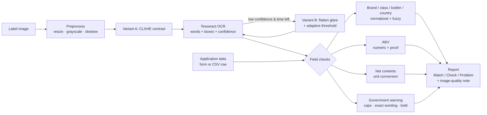

# Architecture

## Requirements distilled from the interviews

| Source | Requirement | Where it's handled |
|---|---|---|
| Sarah | Results in ~5 s or agents won't use it | Local OCR (~0.5 s), single fast pass with a conditional second pass |
| Sarah | Usable by a 73-year-old; half the team is 50+ | Two numbered steps, one big button, 18 px base text, plain-language results |
| Sarah / Janet | Batch uploads of 200–300 labels | `POST /api/batch` + CSV manifest, parallel workers, progress bar, CSV export |
| Marcus | Firewall blocks outbound ML endpoints | Tesseract + OpenCV run in-container; zero outbound calls |
| Marcus | Don't store anything sensitive | Images processed in memory only; batch results expire after 1 h; no database |
| Marcus | Standalone, no COLA integration | Self-contained container; application data typed in or uploaded as CSV |
| Dave | `STONE'S THROW` = `Stone's Throw` — use judgment | Normalized comparison; fuzzy matches go to "Check", not "Problem" |
| Jenny | Warning must be exact, header ALL CAPS + bold | Case-sensitive header check, word-level diff vs statute, stroke-weight bold heuristic |
| Jenny | Handle angled / glary photos | Auto-deskew, CLAHE contrast, illumination-flattening fallback |

## Flow

## Layers

- **`app/pipeline/preprocess.py`** — pure OpenCV. Resizes to 1100–2000 px on the long side (small print stays legible, big phone photos don't slow OCR), estimates skew from Hough line segments (±20°), and builds two variants: CLAHE local contrast (default) and an illumination-flattened adaptive threshold (glare/shadows).
- **`app/pipeline/ocr.py`** — `TesseractExtractor` behind a tiny `Extractor` protocol. Returns words with bounding boxes and confidences. Swapping in another engine (e.g. an Azure-hosted vision model inside the agency's tenant) means implementing one method.
- **`app/checks/*`** — one module per rule, each a pure function `(expected, ocr) -> CheckResult`. No I/O, so they're unit-tested on plain strings.
- **`app/pipeline/verify.py`** — orchestrates: runs OCR (with the conditional retry), runs every check, rolls up the worst status, and attaches an image-quality note so a "poor" scan can never come back as a clean pass.
- **`app/batch.py`** — in-memory job store + bounded `ThreadPoolExecutor`. Tesseract is a subprocess, so threads give real parallelism; `OMP_THREAD_LIMIT=1` prevents per-process thread contention.
- **`app/routes.py` + `templates/` + `static/`** — Flask, one HTML page, vanilla JS. No build step, nothing to break on a locked-down network.

## Status model

| Status | Meaning | Typical cause |
|---|---|---|
| **Match** | Label agrees with application | Exact or format-only difference |
| **Check** | Probably fine; human should glance | OCR-level differences, bold not confirmable, proof ≠ 2×ABV |
| **Problem** | Clear mismatch or missing element | Wrong ABV, title-case warning, reworded warning, field not found |
| Not checked | Optional field left blank | Bottler, country of origin, ABV on wine/beer |

Overall result = worst individual status. Results sort problems first so agents see what matters immediately.

## Government warning check in detail

1. **Header** — regex tolerant of OCR spacing finds `government warning`; the matched raw text must be all uppercase. Title case → Problem. Missing colon → Check (OCR often drops punctuation).
2. **Body** — tokens after the header are diffed word-by-word against 27 CFR 16.21 with `difflib`. Trailing label text after the statement is ignored. If all differences are same-length near-spellings ("pregnaney") and overall similarity ≥ 93% → Check (scanner noise). Any added, missing, or substituted words → Problem, with the exact difference shown.
3. **Bold** — for each word box, stroke width ≈ 2·ink area / contour perimeter. Header ÷ body ≥ 1.2 → bold confirmed; < 1.05 → "may not be bold"; in between → "couldn't confirm". Always advisory (Check, never Problem): measuring font weight from photos isn't reliable enough to reject on.

## Scaling path (not built)

For production volume: move batch jobs to a durable queue (Azure Service Bus / Storage Queue) with stateless workers, keep results in short-TTL storage per retention policy, add SSO (Entra ID), audit logging, and integrate with COLA to pull application data instead of manual entry/CSV.
